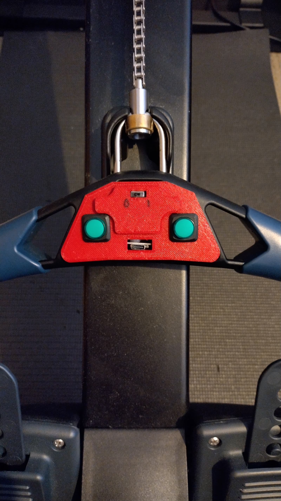
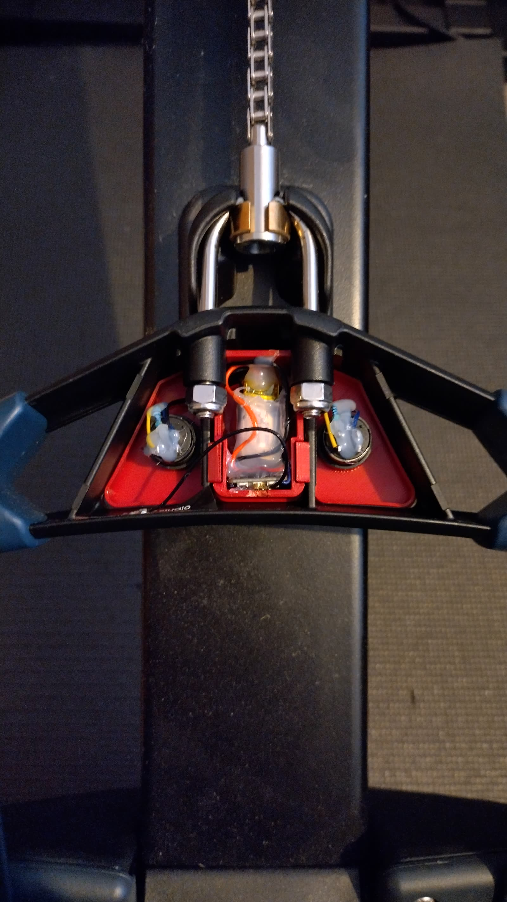
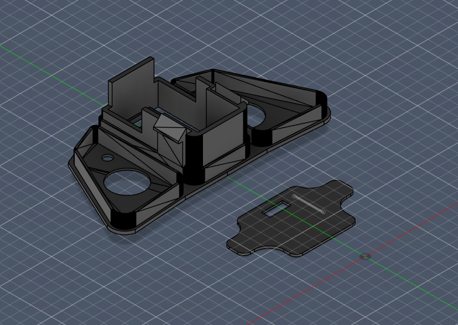

# Rowing Audio Remote

BLE media remote for a **Concept2 rowing machine**: two buttons, two LEDs, mounted on the handle where you can hit them mid-stroke to skip tracks or change volume without touching your phone. Runs on an ESP32-C3 and shows up as a standard Bluetooth HID device — no companion app needed.

  
  

  

## Features

- Advertises as a BLE HID consumer-control device (`Rowing Remote v2`) — pairs like a keyboard, works with any OS/phone that supports BLE HID media keys
- Two modes, toggled by holding both buttons for 1s:
  - **Mode 1**: prev track / next track
  - **Mode 2**: volume down / volume up
- Debounced buttons, keys fire on release
- LEDs flash twice on BLE connect and on mode switch, and light solid while their button is held
- "Still on" reminder: after 10 min with no button presses, both LEDs blink briefly every 10s
- Auto-sleep: after 60 min idle while connected (5 min while disconnected), both LEDs light for 1s, BLE shuts off and the board light-sleeps. Press either button to wake it; it restarts and reconnects to the paired device on its own (the waking press doesn't send a key)

## Hardware

- [Seeed Studio XIAO ESP32-C3](https://core-electronics.com.au/seeed-studio-xiao-esp32c3-tiny-mcu-board-with-wi-fi-and-ble-battery-charge-supported-power-efficiency-and-rich-interface.html) — buttons and battery are soldered directly onto this board (no separate protoboard)
- 2x [16mm illuminated momentary pushbutton (green)](https://core-electronics.com.au/16mm-illuminated-pushbutton-green-momentary.html) — button + LED in one unit
- [120mAh LiPo battery](https://core-electronics.com.au/lipo-polymer-lithium-ion-battery-120mah.html) — plugs into the XIAO's onboard charge circuit
- [Breadboard slide switch](https://core-electronics.com.au/breadboard-slide-switch.html) — wired in series with the battery, as the on/off switch
- Enclosure: [`models/Body.step`](models/Body.step) — clips onto a Concept2 handle, adapted from [Concept2 Rower Handle Media Controller Adapter](https://www.printables.com/model/488265-concept2-rower-handle-media-controller-adapter) on Printables

> The XIAO ESP32-C3 charges the LiPo on-board, but its BLE antenna is **external** — you must fit the u.FL antenna that ships with the board or range will be terrible/nonexistent.
>
> The slide switch sits in series with the battery, so it must be in the **on** position for the battery to charge over USB, not just to run the device.

| Function | GPIO |
|---|---|
| Button — prev / vol down | 7 |
| Button — next / vol up | 8 |
| LED — pairs with GPIO7 button | 21 |
| LED — pairs with GPIO8 button | 20 |

Wiring: button GPIO → button → GND (internal pullup, active-low). LED GPIO → 220Ω resistor → LED anode, cathode → GND (active-high). Both polarities are configurable in the sketch if your wiring differs.

## 3D printing

Printed on a Creality Ender 3 V3 SE, PLA, 10% infill, 3 wall loops, no supports needed, everything else stock slicer defaults. Electronics are hot glued into the body of the print; the assembled unit then clips onto the handle.

## Install

1. [Arduino IDE](https://www.arduino.cc/en/software) → **File > Preferences** → add this to *Additional Board Manager URLs*:
   `https://raw.githubusercontent.com/espressif/arduino-esp32/gh-pages/package_esp32_index.json`
2. **Tools > Board > Boards Manager** → install `esp32` (Espressif Systems)
3. **Sketch > Include Library > Manage Libraries** → install **NimBLE-Arduino** (v2.x)
4. **Tools > Board** → pick your ESP32-C3 dev board
5. Open `RowingMachine.ino`, connect the board over USB, hit **Upload**

## Usage

Power it on, pair `Rowing Remote v2` from your phone/laptop's Bluetooth settings like any keyboard. Tap a button to send the mapped media key. Hold both buttons for 1s to switch modes (LEDs flash to confirm).

## Battery

On the 120mAh LiPo, unoptimized firmware runs the ESP32-C3 fully active the whole time it's powered on (no sleep, continuous GPIO polling, default BLE connection interval) — roughly **4-8 hours of continuous runtime**. This branch trims that by underclocking the CPU (160→80MHz) and widening the BLE connection interval/latency in the `CONFIG` block, at the cost of up to ~1s of button-press lag. Turning the unit off via the slide switch after each session remains the biggest lever either way, since there's no phantom drain when off.

The largest remaining win — automatic light-sleep between BLE connection events (~1mA idle vs ~20-30mA active) — needs sdkconfig-level changes (`CONFIG_PM_ENABLE`, `CONFIG_FREERTOS_USE_TICKLESS_IDLE`) not exposed by stock Arduino IDE, and hasn't been implemented or tested on hardware. Worth investigating if you want to push runtime further.

If you forget to switch it off, idle auto-sleep (see Features) cuts the draw to an estimated ~0.15-0.3mA for the whole board. That means weeks instead of hours on a forgotten unit. Not measured on hardware yet. The slide switch is still best for storage. Deep sleep would draw less, but the ESP32-C3 can only wake from deep sleep on GPIO0-5, and the buttons are on GPIO7/8.

Battery % isn't reported: the XIAO has no battery-voltage sense. Adding it needs a 2-resistor divider (e.g. 2x 220kΩ) from the battery + pad to a free ADC pin, after which the firmware could report % over the standard BLE Battery Service.

To change pins, timings, or the device name, edit the `CONFIG` block at the top of `RowingMachine.ino`.

## Credits

3D model based on [Concept2 Rower Handle Media Controller Adapter](https://www.printables.com/model/488265-concept2-rower-handle-media-controller-adapter) by its original author on Printables.

## License

MIT — see [LICENSE](LICENSE).
